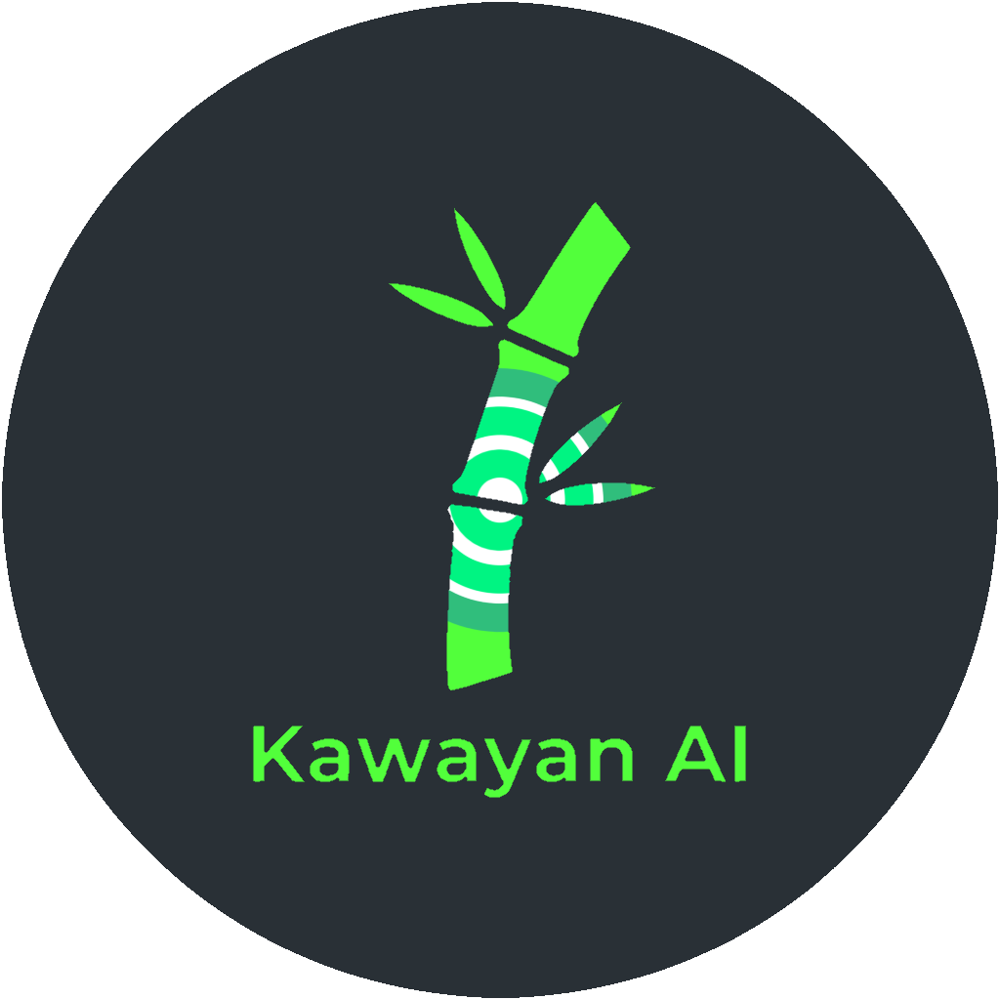

# Kawayan

Kawayan plans, writes, and schedules social media posts for small businesses in the Philippines. A business owner fills in a short brand survey. Kawayan then drafts a month of Facebook and Instagram posts in Taglish, with captions and images, and puts them on a calendar where the owner can edit them before they go out.

This is our capstone project. It runs end to end: real accounts, a real database, payments through PayMongo in test mode, and posting to connected Facebook and Instagram pages. It hasn't been used by paying customers, and some parts are sized for a demo, not for heavy traffic. See [Limitations](#limitations).

## What it does

**For business owners.** Sign up, answer the brand survey (industry, tone, audience), and upload a business document for verification. Then generate a whole month's content plan in one go, or write single posts in the post studio with a phone-sized preview. Each post sits on a timeline with one lane per connected account, and moves from draft to scheduled to published. The insights page compares how posts performed and exports the numbers.

**For support staff.** A ticket queue, plus in-app video calls with users over WebRTC.

**For admins.** Approving business verifications, managing users and wallet balances, checking pending payments, and reading the audit log.

The free trial allows 8 posts a month. Pro is ₱499 a month for 16 posts and deeper analytics. Extra posts cost ₱150 each from the wallet.

## How it's built

| Part | What we used |
| --- | --- |
| Frontend | React 19, TypeScript, Vite, Tailwind 4 |
| UI components | shadcn/ui on Base UI, themed with our own palette |
| Backend | Express 5, Zod for request validation, Socket.IO for support chat and call signalling |
| Database and file storage | Supabase (Postgres) |
| Text generation | `gpt-oss-120b` on Groq, falling back to Cloudflare Workers AI |
| Image generation | Stable Diffusion XL on Cloudflare Workers AI |
| Payments | PayMongo (GCash, Maya, cards) |
| Posting to Facebook and Instagram | Zernio |
| Email | Resend |
| Hosting | Render (`render.yaml`) |

Groq goes first because it's faster. When it hits its free daily limit, Cloudflare takes over with the same model.

## Running it locally

You'll need Node 20 or newer and a free Supabase project.

1. Install dependencies.
   ```sh
   npm install
   ```
2. Copy the environment file and fill it in. Each variable has a comment explaining where to get it.
   ```sh
   cp .env.example .env
   ```
   Only the Supabase keys are required for the app to start. The other keys turn on features: Groq or Cloudflare for AI, PayMongo for payments, Zernio for posting, Resend for email.
3. In the Supabase SQL editor, run `scripts/supabase_schema.sql`. Running it again is safe.
4. Start the frontend and API together.
   ```sh
   npm run dev:full
   ```
   The app opens at <http://localhost:3000>. The API runs on port 3001.

Other scripts:

```sh
npm run typecheck              # type-check without building
npm run build                  # production build into dist/
npm start                      # serve dist/ and the API from one process
npx tsx tests/<name>.test.mjs  # run one test file
```

The tests in `tests/` are plain `node:assert` scripts. They cover the logic that's easy to break: AI plan validation, timeline lanes, insights maths, admin jobs, and tour placement. Each one prints a line when it passes and throws when it fails.

## Project layout

```
src/
  components/   React screens, grouped by area (calendar, admin, auth, landing, tour)
  components/ui shadcn/ui components (dialog, menu, sheet, popover, tabs, and so on)
  styles/       theme.css holds every colour, font, radius and shadow token
  services/     Clients for AI, payments, social, support, and Supabase
  utils/        Tier limits, insights maths, mailer, session helpers
  constants/    Industries, brand voices, terms of service text
server.js       Starts the API: middleware, static files, and the routes below
server/
  routes/       One file per area: auth, posts, payments, admin, verification, social, support, ai
  shared.js     Auth checks, the Zod validate() helper, and the database client
  realtime.js   Socket.IO for support chat, calls, and live updates
public/         Logo, privacy policy, and terms pages
scripts/        Supabase schema
tests/          Test scripts
```

Every request body is checked with a Zod schema before it reaches the database, and anything not in the schema is dropped. The schemas sit at the top of each route file.

To add a shadcn component, run `npx shadcn@latest add <name>`. Its colors come from the tokens in `src/styles/theme.css`, so it follows the light, dark, Cool Slate, and Terracotta themes without extra work.

## Limitations

- PayMongo runs in test mode, so no real money moves.
- Posting works for Facebook and Instagram only.
- The AI providers are on free tiers, so many plan generations in one day can hit the daily limit.
- Render's free plan sleeps when idle. The first request after a quiet period can take up to a minute.

## Team

| Name | GitHub |
| --- | --- |
| Karl Benjamin Bughaw | |
| Jhanric Pablo | [@jhanric-pablo](https://github.com/jhanric-pablo) |
| | [@AfgunIsGun](https://github.com/AfgunIsGun) |
| | [@arod821](https://github.com/arod821) |

## License

BSD 2-Clause. See [LICENSE](LICENSE).
